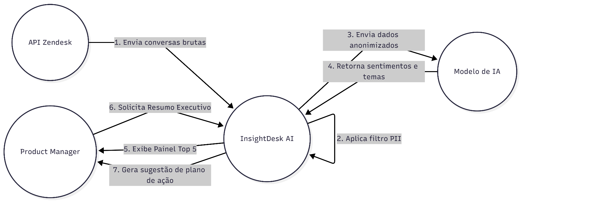
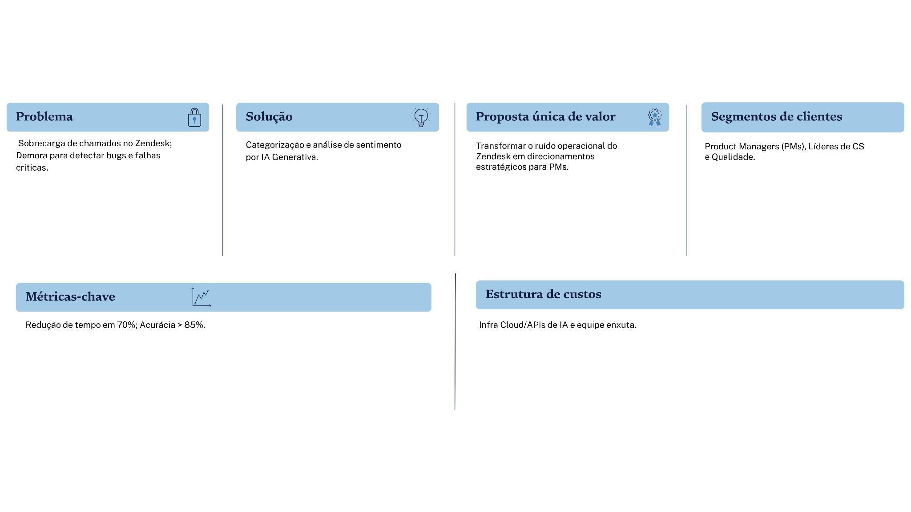
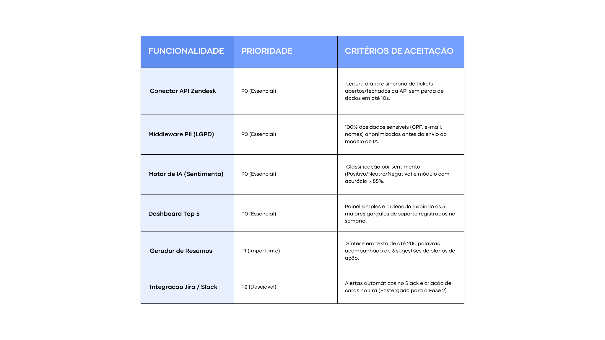
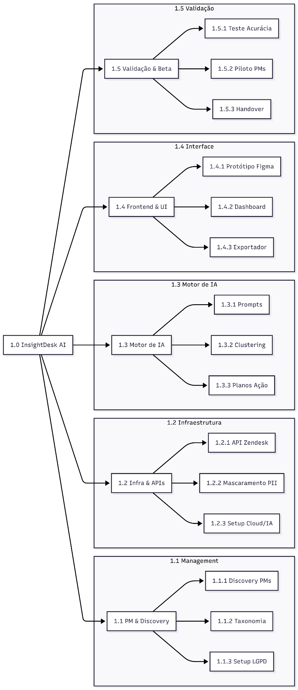
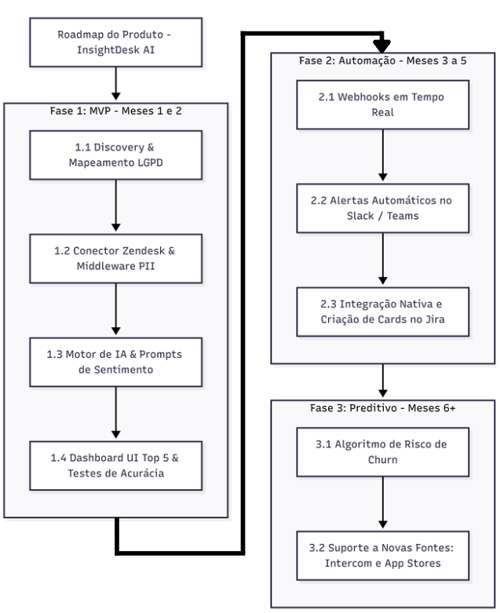
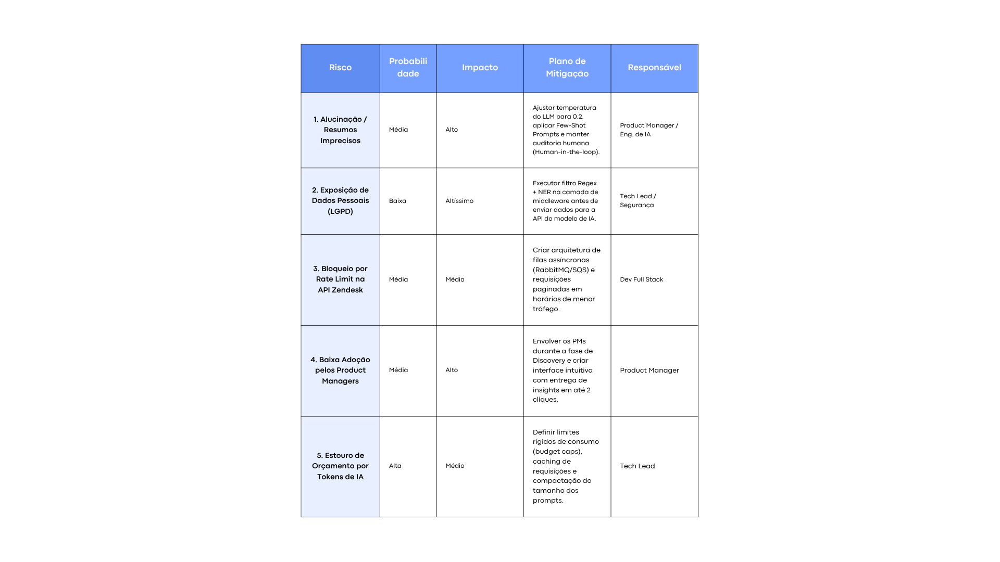

# InsightDesk AI: planejamento de um produto com IA generativa

> Projeto acadêmico de **gestão de projetos e produto**: planejamento completo de uma plataforma B2B que usa **IA generativa** para transformar tickets do Zendesk em insights para Product Managers, desde o termo de abertura até o roadmap, os riscos e a governança de IA e LGPD.

**Autor:** Bruno de Campos Farias, no papel de Product Manager · **Tipo:** planejamento (sem implementação)

## O problema

Empresas acumulam milhares de tickets de suporte no Zendesk, mas ninguém consegue ler tudo. Bugs graves demoram para ser notados, sugestões de melhoria se perdem e os PMs decidem por intuição.

## A proposta

O InsightDesk AI se conecta ao Zendesk, **anonimiza os dados pessoais**, usa IA para classificar tema, sentimento e urgência de cada ticket e entrega aos PMs um painel com as **5 maiores dores da semana**, além de resumos executivos com sugestões de ação.

**Metas do projeto:** MVP em 8 semanas, acurácia acima de 85% na classificação e redução de 70% no tempo para identificar falhas. Como é um planejamento acadêmico, esses números são metas, não resultados medidos.

## O que o planejamento cobre

| Artefato | Conteúdo |
| --- | --- |
| **Termo de abertura** | Justificativa, objetivos SMART, premissas, restrições e equipe (PM, Tech Lead de IA, Dev Full Stack, UX/UI) |
| **Escopo** | O que entra no MVP e o que fica de fora, como resposta automática a clientes e outras plataformas além do Zendesk |
| **EAP** | Cinco frentes: gestão e discovery, infraestrutura, motor de IA, interface e validação |
| **MVP** | Funcionalidades priorizadas por valor vs. viabilidade, com critérios de aceitação |
| **Roadmap** | 3 fases: MVP, automação (Slack, Jira) e inteligência preditiva (risco de churn) |
| **Ciclo de vida** | Discovery, validação, entrega e evolução, com critérios objetivos para avançar de fase |
| **Riscos** | Matriz com probabilidade, impacto, mitigação e responsável |
| **IA e LGPD** | Riscos de IA, ética, criptografia, anonimização e retenção de dados |

### Escopo do MVP

### Estrutura analítica do projeto (EAP)

### Roadmap

### Matriz de riscos

## Decisões de IA que se destacam

- **Modelo de mercado via API**, com engenharia de prompt e RAG leve, em vez de treinar um modelo do zero: menos custo e menos tempo para provar valor.
- **Anonimização antes da IA:** um middleware com regex e NER mascara CPF, e-mail, nome e telefone antes de qualquer texto sair para o modelo.
- **Contra alucinação:** temperatura baixa (0.2), prompts de sistema restritos e revisão humana (*human-in-the-loop*).
- **Custo sob controle:** limite de orçamento na API, cache de requisições repetidas e prompts enxutos.
- **Validação antes de construir:** teste cego com 1.000 tickets históricos comparando a IA com analistas humanos; só avança para a entrega com acurácia de 80% ou mais.
- **Transparência:** a interface indica claramente o que foi gerado por IA.

## Documento completo

O planejamento completo, com todos os artefatos, está em [`docs/insightdesk-ai-planejamento.pdf`](docs/insightdesk-ai-planejamento.pdf).
